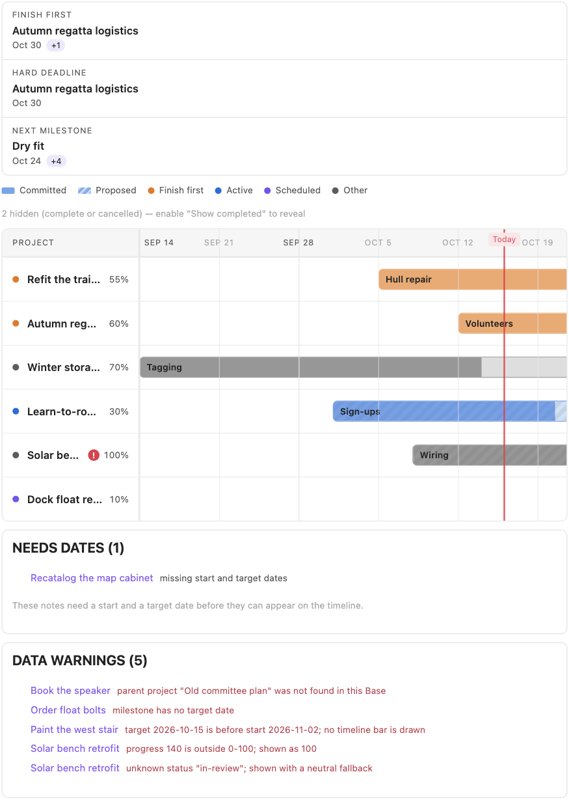
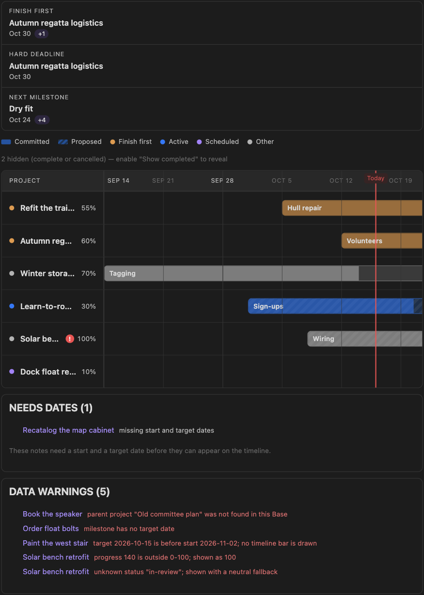
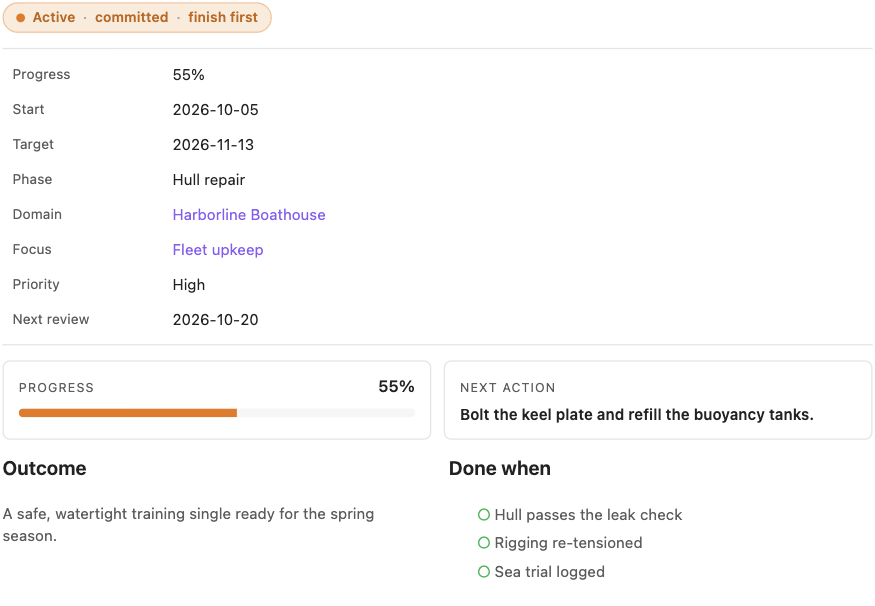

# Project Dashboard

A small, read-only Obsidian plugin that turns native note properties into a
project dashboard:

- a **horizontal project timeline** implemented as a custom Bases view, and
- a **project-note summary** rendered from the current note's own properties.

No writes, no network, no telemetry, no background polling. Notes stay
ordinary Markdown, and the Base stays usable without the plugin.





## What you get

- Timeline bars positioned from the native `start` and `target` properties,
  with manual progress fills, milestone markers, status colors, and distinct
  styling for `proposed` (striped) vs `committed` (solid) timing.
- A derived focus strip — **Finish first**, **Hard deadline**, **Next
  milestone** — computed from the notes, with `+N` counts and calm empty
  states. Nothing in the strip is configured by hand.
- A `project-summary` code block that renders the current note's properties
  (status, progress, dates, domain/focus links, outcome, done-when) as a
  compact header card.
- Non-fatal behavior for imperfect data: missing dates, invalid dates,
  out-of-range progress, and unknown enum values are reported, not invented.
- Light and dark theming through Obsidian variables, and usable narrow panes.



Screenshots are captured from the real Obsidian app (1.14.4) running the
fictional demo vault; the repository also ships a deterministic
Chromium-based harness for regenerating its own shots without the app.

## Install

Manual install from a clone (no releases are published yet):

```sh
npm ci
npm run build
mkdir -p "<vault>/.obsidian/plugins/project-dashboard"
cp main.js manifest.json styles.css "<vault>/.obsidian/plugins/project-dashboard/"
```

Then enable **Project Dashboard** under **Settings → Community plugins**.

> The committed `main.js` is the production bundle produced by `npm run build`; CI
> verifies it is up to date with the sources. If you prefer, rebuild it yourself.

### Try the fictional demo vault

```sh
npm ci
npm run demo:install
```

Open `demo-vault/` as a vault in Obsidian and open `Dashboard.md`. Everything
in it is fictional, and four notes are intentionally malformed so the failure
states are visible.

## Use

1. Add frontmatter to notes following the [canonical schema](docs/schema.md),
   or start from the restrained [templates](templates/).
2. Copy [bases/Projects.base](bases/Projects.base) into your vault (or build
   an equivalent Base) and switch the view layout to **Project timeline**.
3. Optional per view:

   | Option                       | Values                   | Default   |
   | ---------------------------- | ------------------------ | --------- |
   | Scale                        | Automatic, Weeks, Months | Automatic |
   | Show completed and cancelled | On / Off                 | Off       |

4. Add a `project-summary` code block at the top of a project note for the
   property-driven summary card (the project template includes it).

## How failures render

The plugin never invents missing dates:

- One date or no dates → the note is listed under **Needs dates** with the
  missing field named.
- `target` before `start` → warning, no bar.
- Invalid progress → warning, safely clamped for rendering only.
- Unknown enum value → neutral fallback, with the invalid value named in a
  warning.
- Completed / cancelled → hidden unless "Show completed and cancelled" is on.

## Privacy and safety

- Read-only: the plugin never writes to notes, frontmatter, or config.
- No network requests, telemetry, or polling of any kind.
- Minimal startup work: one Bases view registration and one code block
  processor.
- `npm test` includes policy tests that fail if any of the above changes.

## Development

```sh
npm ci           # install dev dependencies
npm run check    # format, lint, typecheck, build, and the full test suite
npm run dev      # watch build for local plugin development
npm run screenshots  # regenerate docs/screenshots with headless Chrome
```

Documentation:

- [Architecture](docs/architecture.md)
- [Canonical schema](docs/schema.md)
- [Installation and removal](docs/installation.md)
- [Verification](docs/verification.md) — automated checks, the visual
  harness, and the manual in-app checklist.

## Limitations (v1)

Read-only by design: no drag-and-drop, no property editing from the timeline,
no Kanban, no task automation, no reminders, no calendar/email integrations.
Progress is supplied manually and never inferred from tasks. The plugin is
developed and tested against desktop Obsidian 1.14.4; mobile is untested.

All screenshots in `docs/screenshots/` use fictional demo data; see
[docs/verification.md](docs/verification.md) for how they are produced and
which checks ran automatically inside the app.

## License

[MIT](LICENSE)
